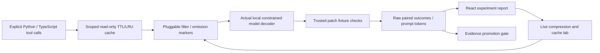

# Lean

Agent tool outputs can waste context or hide critical constraints; Lean measures explicit filtering policies against paired synthetic coding-patch tasks.

## Result

Actual local SmolLM inference: 144 decisions; summary input tokens 24,597 → 6,885 (72.0% fewer); baseline and summary both 5/24 checks passed—a weak model result, **not evidence of preserved autonomous coding ability** ([raw experiment](docs/results/evaluation.json)).
11 tests pass; 3 executable semantic-loss controls expose harm; 100 repeated read-only requests invoke the tool 1 time ([gates](docs/results/gates.txt), [samples](docs/results/bench.json), [promotion rejected](docs/results/rejected-promotion.txt)).
Summary filtering median 819.27 µs for the synthetic report; actual UI recording 93.12 s ([browser proof](docs/results/browser/review.json)); realized dollar savings **not measured**.

## Architecture



## Run it

Python and Node/npm required. The default demo uses a vendored public tokenizer and retained actual inference evidence plus live filtering; it downloads no model weights and needs no account. Open http://127.0.0.1:8092.

```sh
make demo
make lint test bench
make models eval  # Optional: install/download the pinned public model and rerun actual inference.
```

[SDK examples](docs/SDK.md) · [Recording steps](docs/DEMO.md) · [Actual video](docs/results/browser/demo.webm) · [Original UI references](docs/UI_REFERENCES.md)

## Decisions and limits

Contextual motion uses finite transform-only responses to real controls and changed evidence, with live reduced-motion cancellation. See [motion design and validation](docs/MOTION.md); frame rate is not measured.


**Partial for the full proof.** This implements the filters, scoped cache, simplest-patch constraint, Python AST/diff/dependency-manifest signals, both SDKs, real paired inference and a React report. The measured model chooses among trusted patches rather than autonomously writing code. It always selected candidate A, regardless of policy, and succeeds poorly. Equal observed counts do not demonstrate useful agent effectiveness. A configured promotion gate exits nonzero on insufficient success and missing dollar evidence.

| Policy | Input tokens | Reduction | Passed / trials |
|---|---:|---:|---:|
| baseline | 24,597 | 0.0% | 5 / 24 |
| dedupe | 7,749 | 68.5% | 5 / 24 |
| summary | 6,885 | 72.0% | 5 / 24 |
| trim256 | 14,895 | 39.4% | 5 / 24 |
| trim64 | 5,679 | 76.9% | 5 / 24 |
| balanced | 7,221 | 70.6% | 5 / 24 |

Input tokens include the whole model chat template, instructions, tool context and candidates. Seeds permute the same fixed tasks; they are not independent task samples. The decoder ranks candidate-label logits rather than generating unrestricted code. Synthetic reports contain repeated noise that favors compression. No provider invoice, electricity/amortization cost, realized dollars, hosted performance or general coding-agent benefit is measured. Optional UI prices are user assumptions for an input-cost scenario, not a billing claim.

Compression is lossy. Deduplication can change a majority count; truncation can lose the final assertion; structured selection can lose an untagged condition. These executed controls are **not model regressions**. [A real failing test caught source-body loss](docs/results/caught-summary-source-loss.txt); both SDKs were fixed and the full model run repeated. The [original experiment](docs/results/evaluation-before-source-fix.json) remains available.

Caching requires explicitly read-only tools and caller-provided identity/data revision scope. It saves tool executions, not repeated model-context tokens. TTL, entry and raw-payload byte bounds do not include interpreter/key/tokenizer memory. Plugin functions are trusted application code. Complexity signals have false positives for exports/dynamic uses and never automatically rewrite code.

The UI labels recorded inference separately from live lab requests. It supports the complete curve, actual task-level patches/failing checks, optional scenario rates and editable compression/cache inspection. Its default live lab performs no model inference. [Design and guarantees](docs/DESIGN.md) · [ADRs](docs/adr/) · [Quality report](docs/QUALITY.md).

No Stepwise integration is active: the user requires both sides to pass first, and both retain gaps. No existing project was modified, no old repository deleted, no account created and nothing deployed. Docker and Render free-plan templates are prepared only.

[Interview walkthrough](INTERVIEW.md) · [Hard follow-ups](DRILL.md) · [Migration provenance](docs/migration/lean.md) · [CI](https://github.com/rjrddy/lean/actions)

## Next

A preregistered held-out set of open-ended coding tasks with a capable model and actual billed usage; publish paired regressions and uncertainty. Add context-version invalidation, policy shadow mode and stronger identity/ingest controls. Review a provenance-preserving Stepwise importer only after independent acceptance checks pass.
